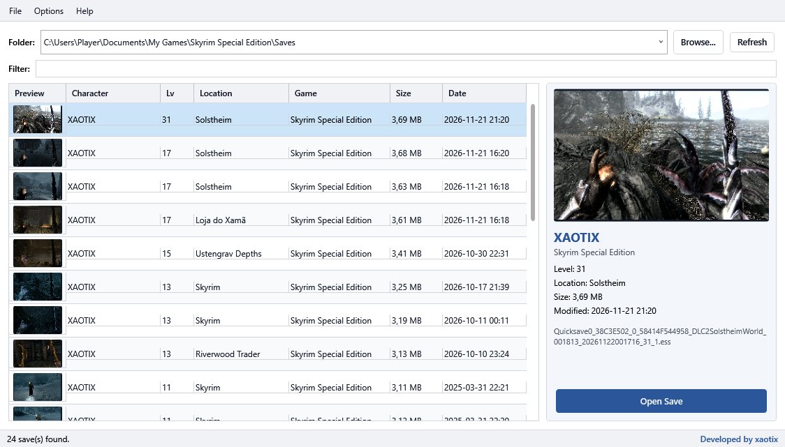
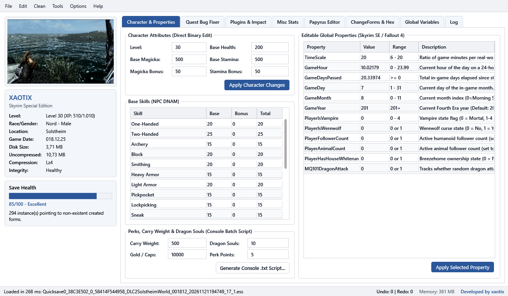
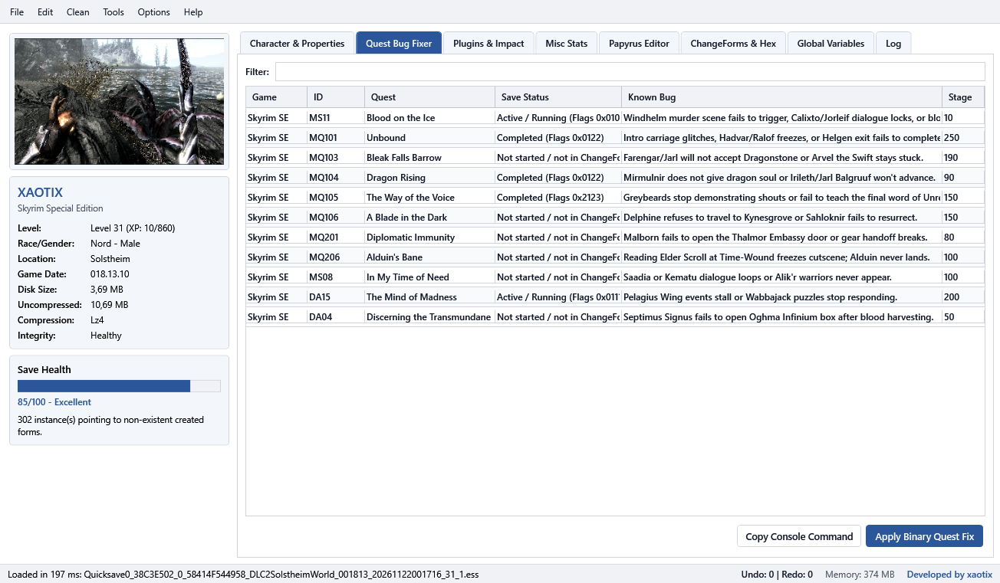
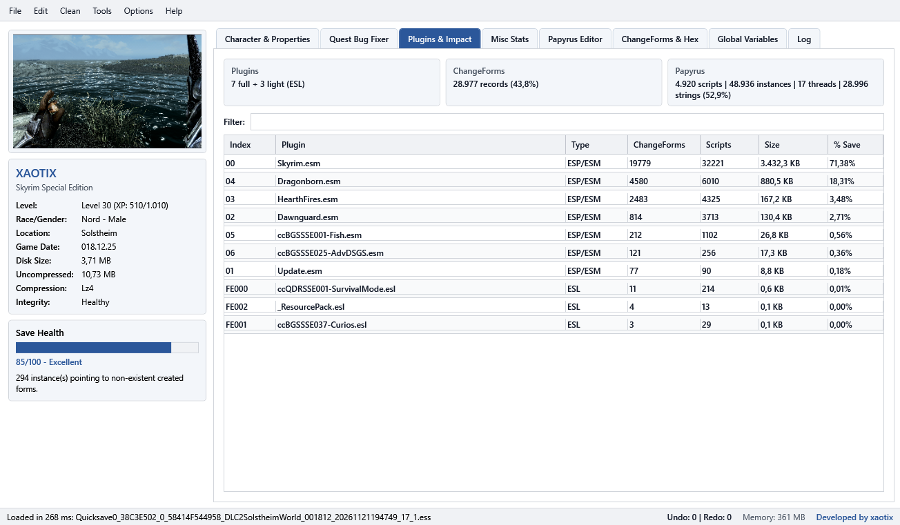
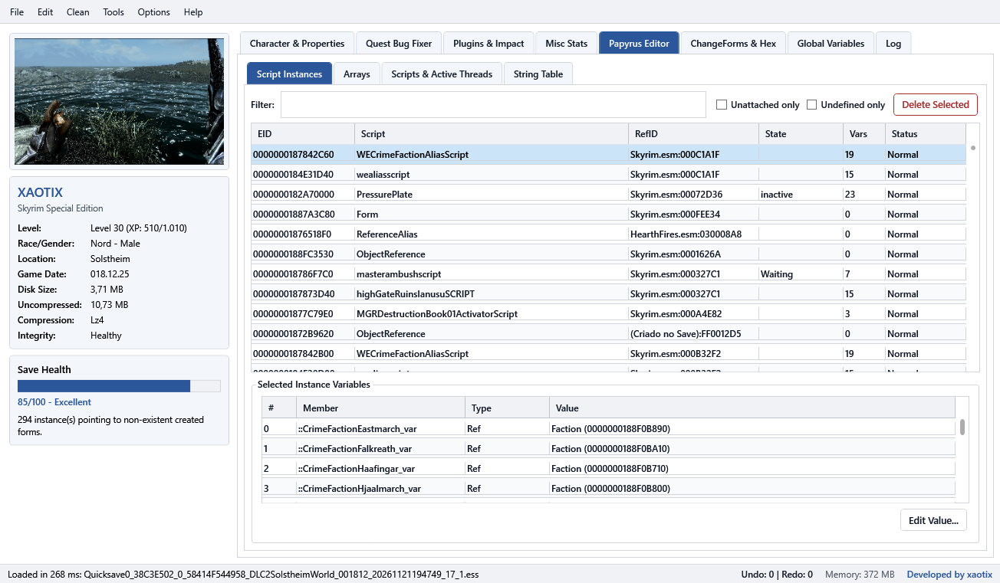
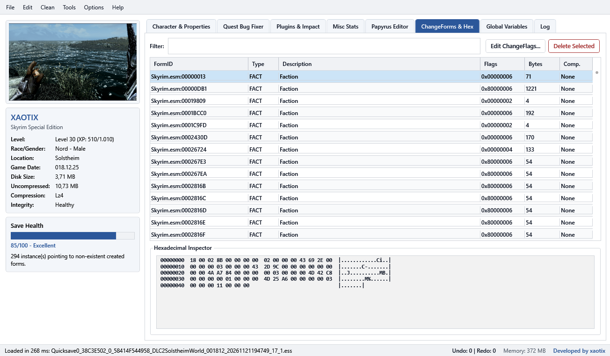
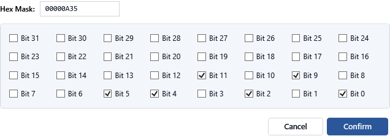
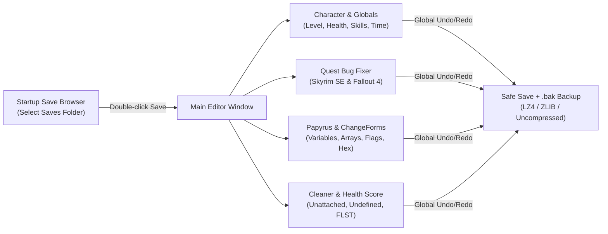

# DLM.BethesdaSaveEditor

A fast, native Windows **WPF (.NET Framework 4.8 / C# 7.3)** savegame editor, analyzer, and cleaner for **Skyrim (LE, SE, VR, Switch)** and **Fallout 4 (Standard & VR)**.

[](#beta-warning)
[](https://github.com/xaotix/DLM.BethesdaSaveEditor/releases/latest)
[-blue?style=for-the-badge)](#requirements)
[](#credits)

---

<a id="beta-warning"></a>
> [!WARNING]
> **BETA SOFTWARE — USE AT YOUR OWN RISK**
>
> **DLM.BethesdaSaveEditor is currently in BETA and may contain bugs or unexpected issues**, especially when directly modifying binary savegame structures across different game versions and heavily modded load orders.
> - Although the editor creates automatic `.bak` backups before saving, **always keep your own manual backup copy of your save files** before making edits.
> - Test edited saves in-game right after saving and report any issues you encounter!

---

## Download

1. Go to the **[Releases](https://github.com/xaotix/DLM.BethesdaSaveEditor/releases/latest)** page.
2. Download **`DLM.BethesdaSaveEditor.exe`** (or `DLM.BethesdaSaveEditor.zip`).
3. Run it directly — **no Java, no installer, and no external DLLs required**.

---

## Screens & Feature Guide

### 1. Startup Save Browser
When you launch the application, it opens the visual Save Browser. It automatically detects your default `Documents\My Games\...\Saves` folders for **Skyrim SE, Skyrim LE, Skyrim VR, Fallout 4, and Fallout 4 VR**, or lets you pick any custom folder.
- Displays save thumbnails, character name, level, location, game edition, file size, and timestamp.
- Shows a large preview panel on the right for the selected save.
- **Double-click** any save (or click **Open Save**) to launch the full editor.



---

### 2. Character & Global Properties Editor
The main editor opens with a persistent left sidebar showing the save screenshot, character metadata, compression type, integrity status, and a **Save Health Score (0–100)** that flags script bloat or orphaned references.
- **Player Attributes & Inventory (Direct Binary Save Edit — `ACHR 00000014`):** Directly edits the player reference (`ACHR 00000014`) in-place without requiring any console scripts:
  - **Skyrim (LE / SE / VR / Switch):** **Level**, **Current XP**, **Health**, **Magicka**, **Stamina**, **Carry Weight**, **Speed (%)**, **Dragon Souls**, **Gold (Septims)**, and **Lockpicks**.
  - **Fallout 4 (Standard & VR):** **Level**, **Current XP**, **Health**, **Action Points (AP)**, **Rads**, **Carry Weight**, **Speed (%)**, **Bottlecaps**, and **Bobby Pins**.
- **Skills & Legendary (Skyrim) / S.P.E.C.I.A.L. (Fallout 4):** Edit all **18 Skyrim Skills + Legendary counts** (synchronized across `ACHR 00000014` ActorValues, `PlayerSkills`, and `NPC_ 00000007`) or all **7 Fallout 4 S.P.E.C.I.A.L.** attributes directly in the save.
- **All Actor Values (`ACHR`):** Inspect and edit every Actor Value stored on the player reference (`Health`, `Magicka`, `Stamina`, `CarryWeight`, `SpeedMult`, `DamageResist`, `DragonSouls`, etc.).
- **Editable Global Properties (Skyrim SE / Fallout 4):** Curated list of safe global variables (`TimeScale`, `GameHour`, `GameDaysPassed`, `GameDay`, `GameMonth`, `GameYear`, `PlayerIsVampire`, `PlayerIsWerewolf`, `PlayerFollowerCount`, `PlayerAnimalCount`, `PlayerHasHouseWhiterun`, `HC_Rule_SurvivalMode`, etc.) with descriptions and recommended ranges.
- **Global Undo / Redo (`Ctrl+Z` / `Ctrl+Y`):** Tracked live in the bottom status bar across all edits.



---

### 3. Quest Bug Fixer (Skyrim SE & Fallout 4)
A built-in catalog of the most common progression-blocking quests in **Skyrim SE** (*Blood on the Ice `MS11`*, *Unbound `MQ101`*, *Bleak Falls Barrow `MQ103`*, *Dragon Rising `MQ104`*, *The Way of the Voice `MQ105`*, *A Blade in the Dark `MQ106`*, *Diplomatic Immunity `MQ201`*, *Alduin's Bane `MQ206`*, *In My Time of Need `MS08`*, *The Mind of Madness `DA15`*, *Discerning the Transmundane `DA04`*) and **Fallout 4** (*When Freedom Calls `Min00`*, *Out of Time `MQ102`*, *Jewel of the Commonwealth `MQ103`*, *Unlikely Valentine `MQ104`*, *Reunions `MQ106`*, *Fire Support `BoS100`*, *The Molecular Level `MQ206`*, *The Secret of Cabot House `MS09`*).
- Scans the loaded save's `QUST` ChangeForms to show each quest's real state (`Active / Running`, `Completed`, or `Not started`).
- Lets you either **Apply Binary Quest Fix** directly to the save or **Copy Console Command** (`setstage`) to paste in-game.



---

### 4. Plugins & Save Impact Analysis
Shows a high-level summary of loaded full (`ESP`/`ESM`) and light (`ESL`) plugins, total ChangeForm records, and Papyrus VM footprint (scripts, instances, active threads, and string table usage).
- Breaks down every plugin's **ChangeForms**, **Script Instances**, **Size (KB)**, and **% of total save size** so you can immediately identify heavy or bloated mods.



---

### 5. Papyrus VM Editor
Deep inspection and editing of the embedded Papyrus virtual machine block across four sub-tabs:
- **Script Instances:** Filter by name, **Unattached only**, or **Undefined only**; delete orphaned instances; inspect and edit instance variables (`Int`, `Float`, `Bool`, `String`, `Ref`).
- **Arrays:** Browse Papyrus arrays and edit, add, remove, or reorder elements (`Shift Up` / `Shift Down`).
- **Scripts & Active Threads:** Inspect running script threads and terminate or delete stuck threads.
- **String Table:** Search, edit, or add strings in the Papyrus string table (with Skyrim LE 65,535-string limit monitoring).



---

### 6. ChangeForms & Hexadecimal Inspector
Inspects all compressed and uncompressed ChangeForm records in the save (`FACT`, `NPC_`, `QUST`, `ACHR`, `REFR`, `FLST`, etc.).
- Search by FormID, plugin name, or record type.
- View the live **Hexadecimal & ASCII Inspector** for any selected record.
- Delete corrupted ChangeForms or open the interactive **ChangeFlags Editor**.



---

### 7. Interactive 32-Bit ChangeFlags Editor
Clicking **Edit ChangeFlags...** opens a visual 32-bit flag mask editor where you can toggle individual bits (`Bit 0`–`Bit 31`) or type a hexadecimal mask directly.



---

## Additional Tools & Safety Features

- **Misc Stats & Crime Bounties (`Misc Stats` tab):** Edit all 108+ Misc Stats inline or clear all Crime Bounties in one click.
- **Global Variables (`Global Variables` tab):** Inline float editing for all save global variables with known vanilla names.
- **One-Click & Batch Cleaning (`Clean` menu):** Remove unattached script instances, undefined elements, non-existent created form instances, purify FormLists (`FLST` null references), or batch-clean an entire folder of saves.
- **Header, Player Location & Compression (`Tools -> Edit Header & Location...`):** Edit player world coordinates (`X/Y/Z`, `Cell X/Y`) and switch save compression (`Uncompressed`, `ZLIB`, `LZ4`).
- **Save Comparator (`Tools -> Compare Two Saves...`):** Compare two saves side-by-side (size, stats, Papyrus counts, added/removed plugins).
- **Multi-Language UI (`Options -> Settings...`):** Switch live between **English**, **Portuguese (Brazil)**, and **Spanish**.
- **Automatic Backups:** Creates timestamped `.bak` backups and preserves SKSE/F4SE co-saves before every save.

---

## Workflow Overview



---

## Building from Source

### Requirements
- Windows 10 / 11
- .NET Framework 4.8
- Visual Studio 2019/2022/2026 or MSBuild with C# 7.3 support

```powershell
msbuild DLM.BethesdaSaveEditor.sln /p:Configuration=Release
```

The standalone executable is generated at `DLM.BethesdaSaveEditor\bin\Release\DLM.BethesdaSaveEditor.exe`.

---

## Credits

- **WPF Edition Developer:** **xaotix**
- **Original Project & Format Research:** **Mark Fairchild / AI-Underdog** — [FallrimTools-Re-Saver](https://github.com/AI-Underdog/FallrimTools-Re-Saver) (Licensed under the Apache License, Version 2.0).
