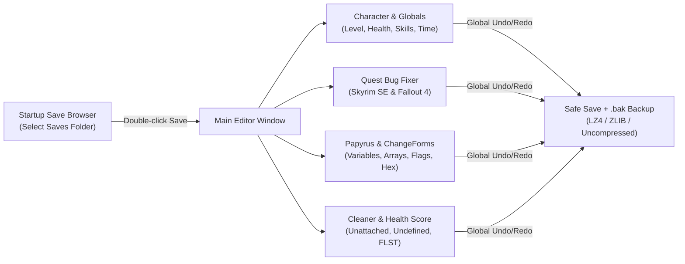

# DLM.BethesdaSaveEditor

A fast, native Windows **WPF (.NET Framework 4.8 / C# 7.3)** savegame editor, analyzer, and cleaner for **Skyrim (LE, SE, VR, Switch)** and **Fallout 4 (Standard & VR)**.

[](https://github.com/xaotix/DLM.BethesdaSaveEditor/releases/latest)
[-blue?style=for-the-badge)](#requirements)
[](#credits)

---

## Download

1. Go to the **[Releases](https://github.com/xaotix/DLM.BethesdaSaveEditor/releases/latest)** page.
2. Download **`DLM.BethesdaSaveEditor.exe`** (or `DLM.BethesdaSaveEditor.zip`).
3. Run it directly — **no Java, no installer, and no external DLLs required**.

---

## Key Features

### 1. Visual Save Launcher (Startup Browser)
- Automatically detects your `Documents\My Games\...\Saves` folders for Skyrim SE, Skyrim LE, Skyrim VR, Fallout 4, and Fallout 4 VR.
- Displays save thumbnails, character name, level, location, game version, size, and date.
- **Double-click** any save to open it in the full editor (or drag-and-drop any `.ess` / `.fos` / `.sav0` file).

### 2. Character & Global Properties Editor
- **Direct Binary Character Editing (`NPC_` `00000007` + Header):**
  - Edit **Level**, **Base Health**, **Base Magicka**, **Base Stamina**, **Magicka/Stamina Offsets**, and **all 18 Base Skills + Skill Bonuses**.
- **Curated Global Properties (Skyrim SE & Fallout 4):**
  - Clear descriptions & safe ranges for `TimeScale`, `GameHour`, `GameDaysPassed`, `GameDay`, `GameMonth`, `GameYear`, `PlayerIsVampire`, `PlayerIsWerewolf`, `PlayerFollowerCount`, `PlayerAnimalCount`, `PlayerHasHouseWhiterun`, `HC_Rule_SurvivalMode`, and more.
- **Console Batch Script Generator:**
  - Export a ready-to-use `.txt` script (`bat`) for runtime ActorValues such as **Carry Weight**, **Dragon Souls**, **Gold / Bottlecaps**, and **Perk Points**.

### 3. Quest Bug Fixer (Skyrim SE & Fallout 4)
- Built-in catalog of the most notorious bugged quests in **Skyrim SE** (*Blood on the Ice `MS11`*, *Unbound `MQ101`*, *Bleak Falls Barrow `MQ103`*, *Dragon Rising `MQ104`*, *The Way of the Voice `MQ105`*, *A Blade in the Dark `MQ106`*, *Diplomatic Immunity `MQ201`*, *Alduin's Bane `MQ206`*, *In My Time of Need `MS08`*, *The Mind of Madness `DA15`*, *Discerning the Transmundane `DA04`*) and **Fallout 4** (*When Freedom Calls `Min00`*, *Out of Time `MQ102`*, *Jewel of the Commonwealth `MQ103`*, *Unlikely Valentine `MQ104`*, *Reunions `MQ106`*, *Fire Support `BoS100`*, *The Molecular Level `MQ206`*, *The Secret of Cabot House `MS09`*).
- Scans your save's `QUST` ChangeForms to show real quest status and applies **direct binary stage fixes** or copies the exact `setstage` console command.

### 4. Save Health Diagnostics, Cleaning & Mod Impact
- **Health Score (0–100):** Automatically flags unattached script instances, undefined Papyrus elements/threads, Skyrim LE 65,535 string table limit warnings, and plugin slot usage.
- **One-Click & Batch Cleaning:** Remove unattached instances, undefined elements, non-existent created form instances, and purify FormLists (`FLST` null refs).
- **Plugin Impact Analysis:** Breakdown of every ESP/ESM/ESL plugin's ChangeForm count, ScriptInstance count, size in KB, and `%` of total save size.

### 5. Deep Binary Editors
- **Papyrus Editor:** Edit ScriptInstance variables (`Int`, `Float`, `Bool`, `String`, `Ref`), edit Papyrus Arrays (`Add`, `Remove`, `Shift Up/Down`), terminate/delete Active Script Threads, and edit/add String Table entries.
- **ChangeForms & Hex Inspector:** Interactive **32-bit ChangeFlags Bit Editor**, raw Hex/ASCII inspector, and ChangeForm deletion.
- **Misc Stats & Player Location:** Edit all 108+ Misc Stats inline, clear all Crime Bounties in one click, and edit Player World Coordinates (`X/Y/Z`, `Cell X/Y`) & save compression (`Uncompressed`, `ZLIB`, `LZ4`).
- **Save Comparator:** Compare two saves side-by-side (size, stats, Papyrus counts, added/removed plugins).
- **Global Undo / Redo (`Ctrl+Z` / `Ctrl+Y`):** Full undo/redo history across all edits, shown live in the footer bar.
- **Multi-Language UI:** English (default), Portuguese (Brazil), and Spanish (`Options -> Settings...`).
- **Automatic Backups:** Creates timestamped `.bak` backups and preserves SKSE/F4SE co-saves before every save.

---

## Workflow Overview



---

## Building from Source

### Requirements
- Windows 10 / 11
- .NET Framework 4.8
- Visual Studio 2019/2022/2026 or MSBuild with C# 7.3 support

```powershell
msbuild DLM.BethesdaSaveEditor.sln /p:Configuration=Release
```

The standalone executable is generated at `DLM.BethesdaSaveEditor\bin\Release\DLM.BethesdaSaveEditor.exe`.

---

## Credits

- **WPF Edition Developer:** **xaotix**
- **Original Author & Format Research:** **Mark Fairchild** — [FallrimTools / ReSaver](https://github.com/MarkDF/FallrimTools) (Licensed under the Apache License, Version 2.0).
